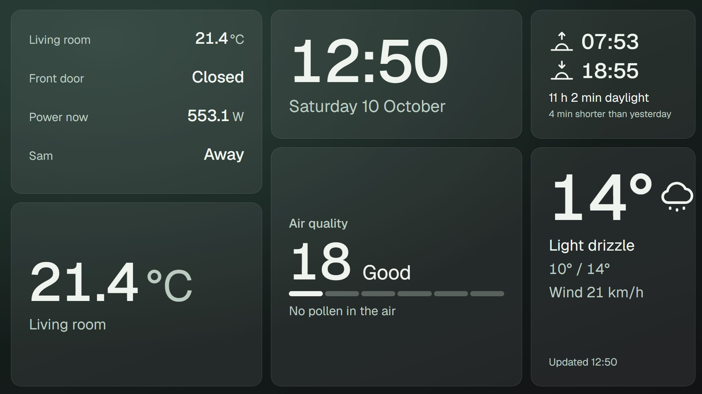
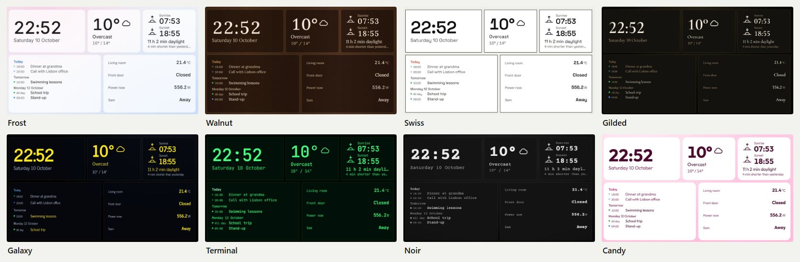
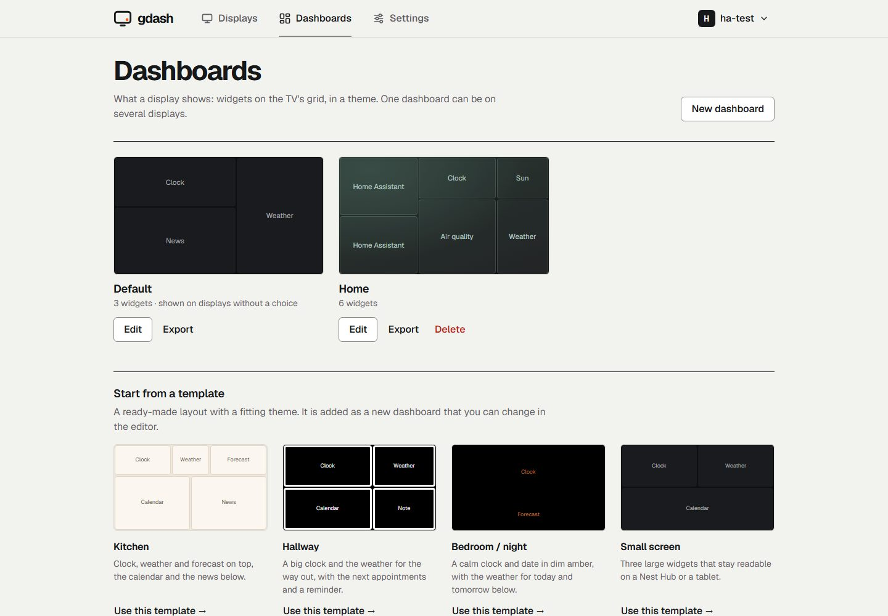
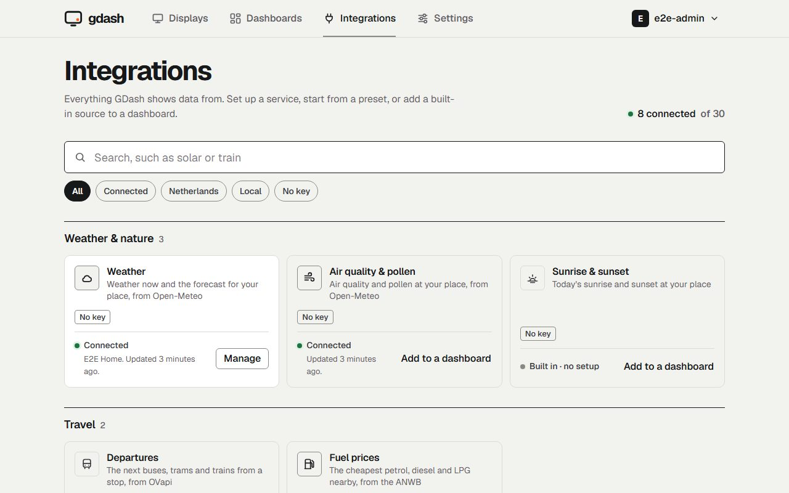

# GDash

**Your household's day on every TV in the house.** GDash is a self-hosted
dashboard for the Chromecast, Google TV, Nest Hub or any browser you already
own: the time, the weather, the family calendar, the next bus, the waste
collection, Home Assistant or Homey sensors and more, on a calm screen that
runs all day. No extra hardware at the TV, no subscription, no cloud account.

> **Status: beta (0.6).** It runs every day on a TV and a Nest Hub at home,
> but has not been used anywhere else yet. Run it on a network you trust.



## Contents

- [Why GDash](#why-gdash)
- [Features](#features)
- [Quick start](#quick-start)
- [Screens it works with](#screens-it-works-with)
- [Configuration](#configuration)
- [Command line](#command-line)
- [Updating and backups](#updating-and-backups)
- [Documentation](#documentation)
- [Development](#development)
- [Security, license and credits](#security-license-and-credits)

## Why GDash

Most home dashboards are built for a phone or a tablet in your hand. A TV in
the kitchen or the hallway is different: it is read from across the room, it
must stay on screen for hours without anyone touching it, and it has to
survive the internet dropping out. GDash is made for exactly that.

- **It uses the TVs you have.** GDash finds Chromecast and Google TV devices
  on your network and keeps the dashboard on them, even past Google TV's
  screensaver. Any other screen opens a web page instead.
- **It runs on one small box.** A single program with an embedded database,
  for a NAS, a Raspberry Pi, a mini PC or a Home Assistant server.
- **It keeps your data at home.** Calendar addresses and tokens are stored
  encrypted, every screen only receives what its own dashboard shows, and
  nothing is sent to a GDash cloud, because there is none.

## Features

### On the screen

| Widget | Shows | Source |
|---|---|---|
| Clock | Time and date | — |
| Weather and forecast | Now and up to seven days; now optionally as measured by the nearest KNMI station | [Open-Meteo](https://open-meteo.com), no key; [KNMI](https://dataplatform.knmi.nl) with your own free key |
| Sun | Sunrise, sunset and the length of the day | Open-Meteo |
| Moon | The phase, how much is lit, and the next full and new moon | Computed, no network |
| Air quality | Air quality index and pollen (Europe) | Open-Meteo |
| Rain | Rain in the next two hours as bars, and "Rain from 14:20 (light)" | [Buienradar](https://www.buienradar.nl) (Netherlands and Belgium), elsewhere Open-Meteo; no key |
| Weather warnings | The KNMI's code yellow, orange and red warnings for your province, optionally announced on every screen | KNMI through [MeteoAlarm](https://meteoalarm.org) (Netherlands), no key |
| Calendar | The coming week from Google, Outlook, iCloud or Nextcloud | Secret iCal address, no OAuth |
| Waste collection | The next pickup per kind (GFT, PMD, paper, ...) | Your municipality's iCal link |
| Departures | Next buses, trams, metros and ferries at a stop, with delays | [OVapi](https://v0.ovapi.nl) (Netherlands), no key |
| Fuel prices | The cheapest petrol stations near a place | ANWB price data (Netherlands), no key |
| Traffic | Jams, roadworks, mobile speed checks and fixed cameras on your roads | ANWB traffic info (unofficial, off until you turn it on) and [OpenStreetMap](https://www.openstreetmap.org) cameras |
| Energy price | Today's dynamic electricity price per hour, cheapest window | [EnergyZero](https://www.energyzero.nl) (Netherlands), no key |
| Solar forecast | What your solar panels are expected to produce today and tomorrow | Open-Meteo, or [Forecast.Solar](https://forecast.solar), no key |
| Home Assistant | Sensors and switches, such as the temperature or a door | Your Home Assistant, read only |
| Homey | Sensors and switches, and who is home as badges with initials | Your Homey Pro, read only, with an API key |
| News | Headlines from up to ten sources, a different choice per widget | About 50 built-in sources (NOS, NU.nl, Tweakers, regional broadcasters, BBC, tagesschau and more) or any RSS or Atom feed (default: NOS) |
| Photos | A slideshow of photos you upload, or of an album of Immich or Synology Photos | Stored on your server, [Immich](https://immich.app) with an API key, or a Synology Photos share link |
| Now playing | What plays on your Cast speakers, groups and Nest Hubs, with the cover and progress | The devices themselves, read only |
| Note and countdown | A short text, or the days until a date | — |
| Holidays | The coming school holidays of your region and the public holidays (Netherlands) | [Rijksoverheid open data](https://opendata.rijksoverheid.nl), no key; public holidays computed |
| Custom API | A value, a list or labelled values from any JSON API, with rules | Any API you add: open, or with a key, token or password |
| Camera | A still image of a camera at home, refreshed every few seconds | Any snapshot address (Frigate, Reolink, Hikvision, Home Assistant), through GDash |
| Web page | A page such as a Grafana panel or a Home Assistant dashboard, filling the tile | A page you add under Integrations, in a sandboxed frame |

The last good value of every source is kept when the internet drops, and a
screen marks data that has gone stale.

### Looks

- **Thirty-three styles** in four groups: calm essentials (Minimal dark and
  light, Glass, Warm light, High contrast, Night), styles with a character of
  their own (Frost, Walnut, Swiss, Tonal, Candy, Gilded, Riviera), styles
  inspired by films and series (Galaxy, Terminal, Parchment, Neon, Upside
  down, Noir, Mars, Hyperspace, Dark side, Desert planet, Wizard school,
  Middle realm, Rain city, Time machine, Agent 00) and styles inspired by
  games (Shiny hunt, Pocket console, Block world, Quest menu), and styles
  after art movements and patterns (De Stijl, Delft blue, Tessellation,
  Bauhaus, Starry swirl, Golden mosaic, Great wave, Colour field, Memphis,
  Art deco, Risograph, Brutalist), all drawn in CSS with the art behind the data.
- **Thirteen typefaces** that ship with GDash, chosen per dashboard.
- **A night style** that takes over after sunset at your location.
- Texts on the TV in **English, Dutch, German or French**.
- Text sizes from 100 to 200 % per display, and every text colour at 4.5:1
  contrast or more in every style.



### In the web interface

- A **dashboard editor** on the TV's own 16:9 grid: drag, resize, preview with
  your real data before saving. Start from a template or from scratch, and
  export or import dashboards as files.
- **Displays** with their own dashboard, **schedules** (another dashboard on
  weekday mornings or at night), dashboards **in turn**, and **active hours**
  outside which the TV may sleep.
- **Announcements**: a Home Assistant automation posts "The washing machine is
  done" with an API token, and the TVs show it over the dashboard.
- **Integrations** in one place, apart from the other settings: weather,
  news feeds, calendars, Home Assistant, Homey, photos, custom APIs and API
  tokens, next to the built-in sources (fuel prices, departures, electricity
  prices) as a searchable catalogue. Each card says whether it is connected
  and when it last updated, and opens its setup right under it. Presets fill
  in a custom API for a HomeWizard P1, kWh or water meter, P1 Monitor,
  DSMR-reader, Fronius, SolarEdge, Tibber, Electricity Maps, a Quatt heat
  pump, AdGuard Home, Speedtest Tracker, Jellyfin, Plex, Mealie or Todoist:
  type the IP address or key and its values are named.
- **Custom APIs** without code: add any JSON API, test it or paste a sample
  answer, click and name the values to show, then pick them by name in the
  editor and add rules such as "Outside is below 0" that colour the value,
  show a message or announce it on every display. Rules are a small
  expression language, not scripts, so nothing from the web
  interface ever runs as code on the server or the TVs.
- **Two-step login** with an authenticator app, a **backup** download, and an
  **activity log** of logins, pairings and changes.





## Quick start

GDash needs a machine that is always on and on the same network as your TVs.
The full guide, including a Linux service, Windows and the Home Assistant app,
is in [docs/install.md](docs/install.md).

**With Docker Compose** (amd64 and arm64, so also a Raspberry Pi 3, 4 or 5):

```yaml
services:
  gdash:
    image: ghcr.io/stijnvandepol/gdash:latest
    network_mode: host          # needed to find Cast devices with mDNS
    environment:
      TZ: "Europe/Amsterdam"
    volumes:
      - gdash-data:/data
    restart: unless-stopped
    user: "65532:65532"
    read_only: true
    cap_drop: [ALL]
    security_opt:
      - no-new-privileges:true
volumes:
  gdash-data:
```

```bash
docker compose up -d
```

Open `http://<server>:8420/` within an hour and create your account; from
your home network no setup token is needed in that first hour.

**Without Docker:** download the archive for your system from the
[releases](https://github.com/stijnvandepol/gdash/releases), unpack it and run
`gdash` (or `gdash.exe` on Windows).

**Then, in the browser:**

1. Open `http://<your-server>:8420/` and create your account with the setup
   token from the log.
2. Under **Integrations**, choose the location for the weather and add the
   calendars, news feeds, Home Assistant, Homey or a meter you want.
3. Under **Dashboards**, start from a template such as Kitchen or Hallway, or
   build your own.
4. Under **Displays**, add a display and pick your TV. GDash puts the
   dashboard on it within seconds. For any other screen, open the display's
   address in its browser and enter the code it shows at the display.

## Screens it works with

| Screen | How | Tested |
|---|---|---|
| Chromecast with Google TV, Google TV sets | GDash casts and keeps the dashboard in front of the screensaver | 24 hours on a Chromecast HD |
| Nest Hub | The same, as a Cast device | 8 hours, and an hour of style changes |
| Any browser, kiosk, Fire TV, tablet or Raspberry Pi | Opens `/d/<display>` and pairs with a code | Chromium (in the browser tests) |

GDash restarts the cast every 15 minutes (5, 10 or 30 per display, or off),
because Google TV covers a running cast with its screensaver after about 19
minutes, and at once when the page on the TV says it was covered. It waits when another app
such as YouTube is on screen, and when someone takes the TV away from the
dashboard it waits until the TV has been switched off. The dashboard shifts
a few pixels every three minutes to protect OLED screens.

## Configuration

Almost everything is set in the web interface. The server itself takes a few
environment variables:

| Variable | Default | Meaning |
|---|---|---|
| `GDASH_ADDR` | `:8420` | Listen address |
| `GDASH_DATA_DIR` | `data` | Database, encryption key, photos and cached data |
| `TZ` | system | Time zone for "today", for example `Europe/Amsterdam` |
| `GDASH_CAST_APP_ID` | none | App ID of your own registered Cast receiver ([docs/receiver.md](docs/receiver.md)); without it GDash uses the public DashCast receiver |
| `GDASH_TRUSTED_PROXIES` | none | Addresses or CIDR ranges of reverse proxies whose `X-Forwarded-For` and `X-Forwarded-Proto` GDash trusts |
| `GDASH_SCHOOL_HOLIDAYS_URL` | Rijksoverheid open data | Where the school holidays are read; only the end-to-end tests change it, to a stand-in |
| `GDASH_UPDATE_CHECK` | `on` | `off` stops the daily check for a new release, whatever Settings says; apart from the data sources it is the only request GDash makes ([SECURITY.md](SECURITY.md)) |
| `GDASH_TEST_UPSTREAM` | none | For the end-to-end tests only: an `http://` address on the loopback address, such as `http://127.0.0.1:18700`, that stands in for Buienradar, Open-Meteo's rain and solar forecasts, MeteoAlarm, the ANWB's traffic list, Overpass and the KNMI; any other address is refused |

The network needs: TCP 8009 from GDash to the TVs, mDNS (UDP 5353) to find
them, TCP 8420 from the TVs to GDash, and HTTPS from GDash to the internet for
the data sources. See [docs/install.md](docs/install.md#what-the-network-needs).

## Command line

```bash
gdash                          # start the server
gdash discover                 # list the Cast devices on the network
gdash status <address>         # show what a Cast device is doing, without changing it
gdash reset-password <user>    # set a new password (also turns two-step login off)
gdash healthcheck              # exit 0 when the server answers, for Docker
gdash version
```

## Updating and backups

The web interface tells you when a new release is out. With Docker,
`docker compose pull && docker compose up -d`; on a Synology, stop the project
in Container Manager, clean it, delete the old image and build the project
again; a binary is replaced and restarted; the Home Assistant app has an
**Update** button. Your data stays where it is, and before a database upgrade
GDash writes a copy of the database next to it. Every step, also for
automatic updates, is in [docs/install.md](docs/install.md#updating).

GDash also makes a daily copy of the database in `backups/` and keeps the last
seven.

For a backup to keep elsewhere, use **Settings → Account → Backup**: one zip
with the database, the encryption key and the photos. It holds the key to
your calendar addresses and tokens, so keep it like a password. Restoring is
unzipping it into an empty data directory. See
[docs/install.md](docs/install.md#backups).

## Documentation

| Document | For |
|---|---|
| [docs/install.md](docs/install.md) | Installing with Docker, as a Linux service, on Windows or as a Home Assistant app; network, permissions, updating, backups |
| [docs/guide.md](docs/guide.md) | Using GDash: displays, dashboards, styles, widgets, schedules, announcements |
| [docs/api.md](docs/api.md) | The HTTP API, for automations and other clients |
| [docs/receiver.md](docs/receiver.md) | Registering your own Cast receiver |
| [homeassistant/gdash/DOCS.md](homeassistant/gdash/DOCS.md) | The Home Assistant app (experimental) |
| [SECURITY.md](SECURITY.md) | What GDash protects and how to report a vulnerability |
| [CHANGELOG.md](CHANGELOG.md) | What changed per version |
| [docs/progress.md](docs/progress.md) | What has been built and tested, on which devices |

## Development

You need Go 1.26 and Node.js 24.

```bash
cd web && npm ci && npm run build && cd ..   # build the web interface
go build -o gdash ./cmd/gdash                # build the server, with the web interface inside
./gdash
```

```bash
go test ./...               # Go tests
cd web && npm run check     # Svelte and TypeScript checks
cd web && npx vitest run    # web unit tests
cd web && npm run dev       # web interface with hot reload, proxies /api to :8420
```

The browser tests (Playwright) start the built server on `127.0.0.1:8435`
with a temporary data directory, so they never touch your own data or devices:

```bash
cd web && npx playwright install chromium   # once
cd web && npm run e2e
```

Contributions are welcome; read [CONTRIBUTING.md](CONTRIBUTING.md) and
[CODE_GUIDELINES.md](CODE_GUIDELINES.md) first. The design research behind
GDash (Dutch) is in
[GoogleHome-Dashboard/docs/onderzoek](https://github.com/stijnvandepol/GoogleHome-Dashboard/tree/main/docs/onderzoek).

## Security, license and credits

**Security.** Passwords follow NIST SP 800-63B and are hashed with argon2id,
two-step login is optional, secrets (including custom API keys) are encrypted
at rest and never shown again, every screen is
paired and only receives its own data, and the web interface has a strict
Content Security Policy. Report a vulnerability as described in
[SECURITY.md](SECURITY.md).

**License.** GDash is free software under the [GNU Affero General Public
License v3.0](LICENSE): you may run, change and share it, and if you offer a
changed version to others over a network, you offer them its source too. The
web interface links to the source, as section 13 of the license asks.

**Credits.** Weather and air quality by [Open-Meteo](https://open-meteo.com),
departures by [OVapi](https://v0.ovapi.nl), school holidays from the open
data of the [Dutch government](https://opendata.rijksoverheid.nl) (CC0), electricity prices by
[EnergyZero](https://www.energyzero.nl), solar estimates optionally by
[Forecast.Solar](https://forecast.solar), fuel prices from the public data of
the [ANWB](https://www.anwb.nl), rain forecasts by
[Buienradar.nl](https://www.buienradar.nl) (free for non-commercial use with
this credit, which the Rain widget also shows), weather warnings by the
[KNMI](https://www.knmi.nl) through [MeteoAlarm](https://meteoalarm.org), traffic from the ANWB's traffic list,
used unofficially and only when you turn it on (the data belongs to the ANWB; for your own household only),
fixed speed cameras © [OpenStreetMap](https://www.openstreetmap.org/copyright) contributors under the ODbL, and
station measurements by the [KNMI](https://dataplatform.knmi.nl) under CC BY 4.0. Photo albums from
[Immich](https://immich.app) and Synology Photos; the Synology share-link calls follow
[syno-photo-frame](https://github.com/Caleb9/syno-photo-frame). The typefaces are under the SIL Open Font
License; all bundled licences are in [THIRD_PARTY_LICENSES](THIRD_PARTY_LICENSES).
